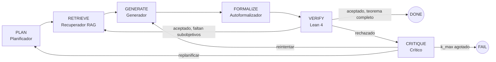

# MathAgents: sistema multiagente con verificación formal en Lean 4

Proyecto final del curso de Inteligencia Artificial (UPTC Sogamoso). Varios agentes basados en un LLM
se reparten la demostración de teoremas tipo olimpiada y **Lean 4 + Mathlib decide si la prueba es correcta**.
Un problema solo cuenta como resuelto si el kernel de Lean lo acepta (RNF-1).

## Arquitectura



| Carpeta | Contenido |
| --- | --- |
| `agents/` | Un archivo por agente: planner, retriever, generator, autoformalizer, verifier, critic |
| `orchestrator/` | Grafo LangGraph (`graph.py`), configuraciones de ablación (`pipeline.py`), líneas base (`baselines.py`) |
| `retrieval/` | Embeddings, índice vectorial (FAISS) y construcción del índice |
| `lean_project/` | Proyecto Lean 4 con Mathlib **v4.34.1** fijada + script de extracción de lemas |
| `core/` | Configuración, cliente LLM, contratos JSON Schema, prompts, registro JSONL |
| `data/` | Dataset curado, teoremas triviales de referencia, ficha del dataset |
| `experiments/` | Ejecución de experimentos, análisis y estadística |
| `notebooks/` | Análisis de resultados y figuras |
| `demo/` | App Gradio para el Hugging Face Space |
| `docs/` | Documentación técnica |
| `tests/` | Pruebas unitarias, de contrato y de integración (pytest) |

## Inicio rápido

Instalación completa en Windows: [`docs/instalacion.md`](docs/instalacion.md).

```bash
pip install -r requirements.txt
cd lean_project && lake exe cache get && lake env lean Smoke.lean && cd ..
pytest -q tests                      # pruebas (las de Lean se saltan si Lean no está)
python -m experiments.smoke_test     # tubería completa con LLM simulado + Lean real
```

Experimentos (requiere un LLM real en `config.yaml` y la variable `LLM_API_KEY`):

```bash
python -m experiments.run_experiment --configuration full --split dev --limit 2
python -m experiments.analyze results/*.jsonl --out results/summary.json
```

## Reproducibilidad (RNF-2)

Cada corrida escribe en `logs/<run_id>.jsonl` un manifiesto con semilla, versión de Lean y Mathlib,
modelo y temperatura del LLM, modelo de embeddings y versiones de librerías. `lean_project/lake-manifest.json`
fija el commit exacto de cada dependencia de Lean.

## Estado

Ver [`docs/estado.md`](docs/estado.md): qué está probado, cómo, y qué falta.

## Licencias

Código: Apache-2.0. Mathlib: Apache-2.0. miniF2F: MIT (versión Lean 4 tomada del repositorio de
DeepSeek-Prover-V1.5, MIT). Revisar la licencia del modelo de embeddings y del LLM usados antes de publicar.
