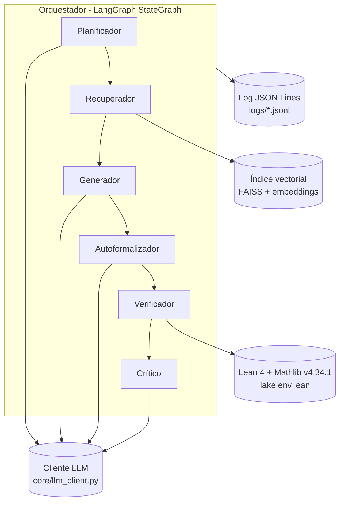

# Documento de arquitectura

## Diagrama de componentes



## Diagrama de secuencia (un subobjetivo con un reintento)

```mermaid
sequenceDiagram
    participant O as Orquestador
    participant P as Planificador
    participant R as Recuperador
    participant G as Generador
    participant A as Autoformalizador
    participant V as Verificador (Lean)
    participant C as Crítico
    O->>P: enunciado (texto + Lean)
    P-->>O: [subgoal_1, ..., teorema principal]
    O->>R: subgoal_1
    R-->>O: k lemas de Mathlib + puntajes
    O->>G: subgoal_1 + lemas
    G-->>O: boceto en lenguaje natural
    O->>A: boceto + lemas
    A-->>O: tácticas Lean
    O->>V: enunciado oficial + tácticas
    V-->>O: rechazado + traza de error
    O->>C: error + historial
    C-->>O: reintentar + consejo
    O->>G: subgoal_1 + consejo
    G-->>O: boceto corregido
    O->>A: boceto corregido
    A-->>O: tácticas nuevas
    O->>V: enunciado oficial + tácticas nuevas
    V-->>O: aceptado
    Note over O: pasa al siguiente subobjetivo;<br/>el teorema principal usa los lemas ya aceptados
```

## Estados del orquestador (sección 6.2 del PDF)

| Estado | Entrada | Acción | Transición |
| --- | --- | --- | --- |
| PLAN | enunciado | descomponer en subobjetivos (chain-of-thought) | RETRIEVE |
| RETRIEVE | subobjetivo | embedding + top-k por similitud coseno | GENERATE |
| GENERATE | subobjetivo + lemas | boceto en lenguaje natural | FORMALIZE |
| FORMALIZE | boceto + lemas | tácticas Lean 4 o "fallo de formalización" | VERIFY |
| VERIFY | código Lean | kernel de Lean | aceptado: siguiente subobjetivo o DONE; rechazado: CRITIQUE |
| CRITIQUE | error + historial | clasificar y decidir | GENERATE / PLAN / FAIL |

Además, antes de cada nodo que usa el LLM se revisa el presupuesto de llamadas por problema
(`orchestrator.llm_call_budget`); si se agotó, el problema termina como FAIL (`llm_call_budget_exhausted`).

## Formalización del RAG (propuesta para la sección 6.4 faltante)

Sea E: texto → ℝ^d el modelo de embeddings con salida normalizada (‖E(t)‖ = 1) y 𝓜 el corpus de
lemas de Mathlib. Para un subobjetivo g:

    sim(g, m) = E(g) · E(m)            (similitud coseno, porque las normas son 1)
    R_k(g)    = los k lemas m ∈ 𝓜 con mayor sim(g, m)

El texto de cada lema es `nombre humanizado : enunciado` (ej. `add sq : (a + b) ^ 2 = ...`).

## Reglas anti-trampa del Verificador (RNF-1)

1. El enunciado lo escribe el Verificador desde el dataset; del LLM solo se toman tácticas.
2. `set_option autoImplicit false`: Lean no inventa variables para identificadores desconocidos.
3. Se rechazan `sorry`, `admit`, `axiom`, `#exit`, `unsafe`, `implemented_by`, `native_decide`,
   `debug.skipKernelTC`.
4. `#print axioms` debe mostrar solo `propext`, `Classical.choice`, `Quot.sound`.
